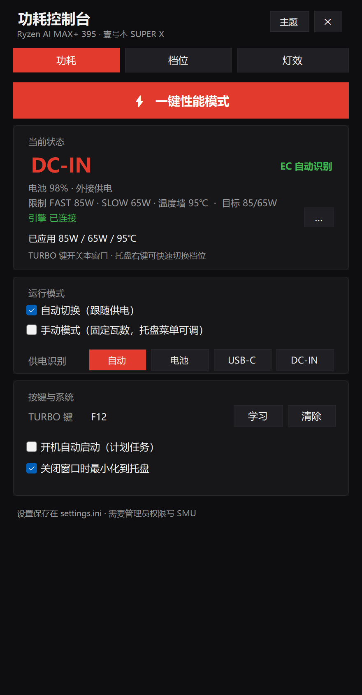
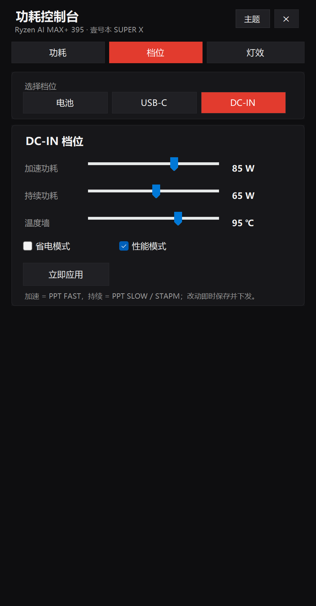

# 功耗控制台 · RyzenPowerTuner

面向 **壹号本 ONEXPLAYER SUPER X**（Ryzen AI MAX+ 395 / Strix Halo）的功耗与机身材质灯控制工具，同时兼容任何使用 `libryzenadj` 的 AMD 平台。

单文件原生程序，无运行时依赖，托盘常驻，按 TURBO 键呼出右侧面板。



## 功能

| 功能 | 说明 |
| --- | --- |
| 功耗档位 | PPT FAST / SLOW / 温度墙，范围 15–120 W，三套档位分别对应电池 / Type-C / DC-IN |
| 供电自动识别 | 读 EC 寄存器 `0xFE`：`1`=电池、`3`=Type-C、`5`=DC-IN；读不到时回退到 AC 状态判断 |
| 一键性能模式 | 120 W + Windows 高性能电源计划一次完成 |
| TURBO 键 | 默认绑定 `Ctrl+Win+Alt`（壹号本 TURBO 键实际发出的组合键），按一下开/关窗口；可重新学习任意键或组合键 |
| 机身材质灯 | 常亮（自定义颜色）、呼吸、19 种 MCU 内置特效；亮度 0–3、速度 0–9；带设备回执自检 |
| 主题 | 壹号本红 / 午夜蓝 / 极简白三套预设，支持自定义五色调色板 |
| 常驻 | 托盘图标、右键快捷菜单、开机自启（计划任务，最高权限） |

## 界面

| 档位 | 灯效 |
| --- | --- |
|  |  |

## 系统要求

- Windows 10 / 11 x64
- .NET Framework 4.8（系统自带）
- 管理员权限（写 SMU 与 EC 必需）
- [libryzenadj](https://github.com/FlyGoat/RyzenAdj) 的 `libryzenadj.dll` 与 `WinRing0x64.sys`
- 可选：`inpoutx64.dll` 与已安装的 `inpoutx64` 驱动服务（用于 EC 供电识别）

## 构建

不需要 Visual Studio 或 .NET SDK，直接用系统自带的 C# 编译器：

```powershell
.\build.ps1
```

产物为 `RyzenTuner.exe`（约 100 KB），把 `libryzenadj.dll`、`WinRing0x64.sys`、`inpoutx64.dll`、`app.ico` 放在同一目录即可运行。

打包安装程序：

```powershell
.\installer\build-installer.ps1
```

生成 `Setup.exe`（单文件，内置全部运行时文件）。

## 使用

1. 把 `RyzenTuner.exe` 与依赖 DLL 放在同一目录，双击运行（会自动请求管理员权限）
2. 首次启动会在同目录生成 `settings.ini` 与 `logs\tuner.log`
3. 按 TURBO 键呼出面板；「档位」页调整各供电下的功耗；「灯效」页调灯
4. 托盘右键可快速切换档位、手动瓦数、退出

## 配置

`settings.ini` 为扁平 `key=value`，常用项：

| 键 | 说明 |
| --- | --- |
| `Mode` | `auto` / `manual` |
| `SourceOverride` | `auto` / `battery` / `typec` / `dcin` |
| `BatteryFast` `BatterySlow` `BatteryTctl` | 电池档位 |
| `TypecFast` `TypecSlow` `TypecTctl` | Type-C 档位 |
| `DcinFast` `DcinSlow` `DcinTctl` | DC-IN 档位 |
| `TurboVk` `TurboScan` `TurboMods` | TURBO 键绑定 |
| `RgbMode` `RgbR` `RgbG` `RgbB` `RgbSpeed` `RgbBrightness` `RgbEffect` | 灯效 |
| `ThemeName` `ThemeBg` `ThemeCard` `ThemeAccent` `ThemeText` `ThemeDim` | 主题 |

## 技术说明

- **功耗**：通过 `libryzenadj` 调用 SMU 的 `set_fast_limit` / `set_slow_limit` / `set_tctl_temp`
- **供电识别**：`inpoutx64` 走标准 ACPI EC 读时序（`0x66` 状态口 / `0x62` 数据口，命令 `0x80`），读取寄存器 `0xFE`
- **灯效**：HID 输出报告，报文首字节为报告 ID `0x00`，随后是 `07 FF <cmd> …`，详见 [docs/PROTOCOL.md](docs/PROTOCOL.md)
- **TURBO 键**：`WH_KEYBOARD_LL` 低级键盘钩子，按扫描码 + 修饰键匹配，避免与普通 Ctrl/Alt 冲突

更多实现细节见 [docs/ARCHITECTURE.md](docs/ARCHITECTURE.md)。

## 已知限制

- 仅在 **壹号本 ONEXPLAYER SUPER X** 上完整验证；其他机型可能需要不同的 EC 寄存器地址
- Strix Halo 默认功耗墙约 55–71 W，超过部分可能被 SMU 拒绝（日志会记录返回值）
- Type-C / DC-IN 区分依赖 EC 访问；若 `inpoutx64` 驱动未安装，会自动回退到「电池 / 外接」两级判断
- 灯效协议按该机型逆向所得，其他机型不保证通用

## 免责声明

修改功耗墙与风扇/温度墙存在过热、降频、硬件损坏的风险。本项目按「现状」提供，作者不对任何直接或间接损失负责。请自行评估后使用。

## 许可证

[MIT](LICENSE)

## 致谢

- [RyzenAdj](https://github.com/FlyGoat/RyzenAdj) — SMU 调参库
- [inpout32](http://www.highrez.co.uk/downloads/inpout32/) — 端口 I/O
- 壹号本社区对 TURBO 键与灯效协议的探索
